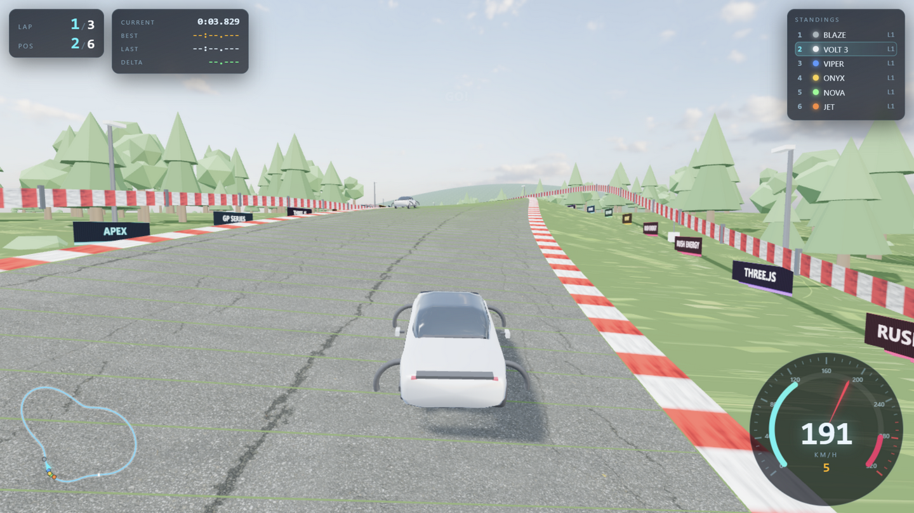

# APEX RUSH — Three.js 街机赛车

一个用 **Three.js** 写的纯前端 3D 街机赛车小游戏。赛道、车辆物理、AI 对手、HUD、音效全部程序化生成；
模型与贴图来自公开的 CC0 素材库（Poly Haven / Kenney）。



---

## 快速开始

**方式一（推荐）：双击 `start.bat`**

会启动一个零依赖的本地服务器（PowerShell 写的，不需要 Node/Python）并自动打开浏览器。
HDR 天空、外置贴图都能正常加载。

**方式二：直接双击 `index.html`**

也能玩。浏览器对 `file://` 的 XHR 有限制，所以此时：

| 资源 | file:// 下的表现 |
|---|---|
| 程序化车身（6 台） | ✅ 代码生成，完全不受影响 |
| 卡丁车 / 交通锥 / 木箱 / 轮胎 | ✅ 用内嵌 base64 数据（`src/assets-embed.js`） |
| 车身贴图集 | ✅ 用内嵌 data URI |
| 沥青 / 草地 / 沙地 / 雪地贴图 | ✅ 正常读取 |
| 天空 HDR | ⚠️ 读不到，自动换成与地图配色一致的程序化渐变天空 |
| 超跑 F8 SPIDER | ⚠️ Draco 解码器需 XHR，会自动退化成同级别的程序化跑车 |

**换端口**：`start.bat -Port 9200`

---

## 操作

| 按键 | 功能 |
|---|---|
| `W` / `↑` | 油门 |
| `S` / `↓` | 刹车（停住后为倒车） |
| `A` `D` / `←` `→` | 转向 |
| `空格` | 手刹漂移 |
| `C` | 切换视角（追尾 / 近距 / 车头 / 电影） |
| `R` | 重新开始 |
| `P` / `Esc` | 暂停 |
| `M` | 静音开关 |

> 小提示：入弯前点一下手刹并反打方向，就能甩出漂亮的漂移（HUD 会显示 DRIFT 计分）。

---

## 玩法

- **5 张地图** × **8 台赛车**，进菜单后先选地图再选车，选地图时背景会实时切换到该赛道
- 5 盏起跑灯亮起后发车，你从最后一位起步，需要一路超车
- HUD 实时显示：圈数、名次、当前圈速、最快圈、上一圈、与最快圈的差值、实时排名、小地图、转速表
- 冲出赛道会掉速（草地/沙地抓地力低），撞护栏会掉速并触发震屏与撞击音
- 跑完设定圈数后进入结算：名次、总用时、最快圈、平均/最高速度、逐圈成绩

### 地图

| 地图 | 特点 | 路面宽 | 长度 |
|---|---|---|---|
| 绿野环道 | 丘陵森林，高速流畅 | 17 m | 1769 m |
| 沙漠峡谷 | 巨石荒原，大起伏长弯 | 18 m | 2347 m |
| 黄昏海岸 | 海边长直道，落日低角度，一侧是海 | 18 m | 1956 m |
| 雪原赛道 | 雪原针叶林，浓雾、能见度低 | 17 m | 1803 m |
| 夜色都市 | 街道夜赛，窄路贴墙，霓虹与万家灯火 | 16 m | 1691 m |

每张地图有独立的赛道形状、起伏、路宽、地表材质、天空 HDR、雾、光照强度和色温，道具主题也不同
（森林 / 仙人掌巨石 / 棕榈沙滩 / 雪松 / 城市楼群 + 路灯）。

### 赛车

| 车辆 | 类型 | 说明 |
|---|---|---|
| VOLT 3 | 电动轿车 | 溜背造型，均衡好开 |
| VOLT Y | 电动 SUV | 高车身，稳但重 |
| APEX GT | 中置跑车 | 带尾翼，操控最好 |
| MINX GTI | 钢炮掀背 | 车身短，弯里灵活 |
| SABLE RS | 运动轿车 | 黑色涂装，偏后驱手感 |
| BRUTE 4X4 | 皮卡 | 又长又重，直道尾速低 |
| F8 SPIDER | 超跑 | 真实模型（Draco 压缩 GLB），综合最强 |
| KART OOLI | 卡丁车 | 慢，但抓地和转向极限极高 |

除 F8 SPIDER 与 KART OOLI 使用外部模型外，其余车身都是**程序化生成**的：沿车长方向放样截面
（腰线以下一个放样体 + 座舱一个放样体，座舱两端高度收到腰线，自然形成前后风挡倾角），
并在前后轴位置抬高车身底面形成轮拱。车漆用 `MeshPhysicalMaterial` 的清漆（clearcoat）+ HDRI 反射。

---

## 技术要点

| 模块 | 说明 |
|---|---|
| `src/track.js` | **地图预设驱动**：极坐标谐波叠加生成闭合赛道中心线（保证不自交），起点区域拉直成大直道；再算弧长重采样、切线/法线标架、带符号曲率、弯道倾斜（banking）；生成路面、红白路肩、缓冲区、护栏、起伏地形、远景群山，以及按地图主题变化的场景细节（针叶林/阔叶林、仙人掌与巨石、棕榈、雪松、城市楼群与路灯、灌木石头、广告牌、弯道外侧交通锥与轮胎墙、裁判岗亭与旗子、弯前刹车距离牌、看台、维修区、发车格白线、海岸水面） |
| `src/carmodel.js` | 程序化写实车模：沿车长方向放样截面——腰线以下一个放样体（顶面即引擎盖/后备箱），座舱另一个放样体且两端高度收到腰线，于是前后风挡倾角是自然形成的；再在前后轴处抬高车身底面做出轮拱开口。另有车轮（Lathe 轮胎 + 轮辋 + 刹车盘）、前后灯、后视镜、尾翼、轮眉。车漆用带清漆（clearcoat）的 `MeshPhysicalMaterial`，靠 HDRI 反射出真车漆面的质感 |
| `src/car.js` | 街机物理：车体坐标系分解速度，横向速度按抓地力指数衰减 → 自然产生推头/甩尾/漂移；偏航角速度同时受「最小转弯半径」与「侧向抓地上限 a_lat = v²/R」约束 → 低速转弯半径真实、高速自然转向不足。车身还有加减速俯仰与过弯侧倾，车轮随速度转动、前轮随方向转动 |
| `src/ai.js` | 纯追踪（pure pursuit）跟随赛车线 + 基于曲率预计算的速度包络（含刹车点反向传播）作为目标速度；带避让、偶发失误、卡住倒车脱困、轻度橡皮筋 |
| `src/hud.js` | Canvas 绘制的转速表/速度表与小地图；DOM 渲染计时与排名 |
| `src/audio.js` | 全部实时合成：多振荡器引擎声（随转速变调、带失真）、轮胎打滑噪声、风噪、碰撞冲击、倒计时提示音。**不依赖任何音频文件** |
| `serve.ps1` | 用 .NET `HttpListener` 实现的静态服务器，带 MIME 类型与路径穿越防护 |

赛道 1400 个采样点、总长约 1774 m，最大坡度与弯道倾角都做了限制，全程约 25 万三角面，
在普通独显上可稳定 200+ FPS。

---

## 目录结构

```
index.html              入口
start.bat               一键启动本地服务器
serve.ps1               本地静态服务器
src/
  style.css             UI 样式
  utils.js              数学/时间/程序化贴图工具
  track.js              地图预设 + 赛道生成与查询
  carmodel.js           程序化写实车模（放样车身 / 车轮 / 灯具）
  car.js                车辆组装 + 街机物理
  ai.js                 AI 车手
  hud.js                仪表盘 / 小地图 / 排名
  audio.js              WebAudio 合成音效
  game.js               主循环、地图与车辆选择、比赛流程
  assets-embed.js       自动生成的内嵌模型（file:// 兜底）
vendor/
  three.min.js          Three.js r147（UMD 构建，便于 file:// 直开）
  GLTFLoader.js / RGBELoader.js / DRACOLoader.js
  draco/                Draco 解码器（超跑模型是 Draco 压缩的）
assets/
  models/               Kenney 道具 + 卡丁车 + 超跑（.glb）
  models/Textures/      colormap.png 车漆色板
  textures/asphalt/     沥青 diffuse
  textures/grass/       草地 diffuse
  textures/sand/        沙地 / 沙滩 diffuse
  textures/snow/        雪地 diffuse
  hdri/                 5 张天空 HDR（sky / desert / sunset / winter / night）
tools/
  make-embed.ps1        重新生成 src/assets-embed.js
```

---

## 素材来源与授权

| 素材 | 来源 | 授权 |
|---|---|---|
| 交通锥 / 木箱 / 轮胎 / 卡丁车 | [Kenney Car Kit](https://kenney.nl/assets/car-kit) | **CC0 1.0**（见 `assets/KENNEY_LICENSE.txt`） |
| 超跑模型 `ferrari.glb` | three.js 官方示例资源 `examples/models/gltf/ferrari.glb` | 见 three.js 仓库说明 |
| 天空 HDR × 5（晴 / 沙漠晴空 / 落日 / 冬日 / 星夜） | [Poly Haven](https://polyhaven.com/hdris) | **CC0 1.0** |
| 沥青 `asphalt_02` | [Poly Haven](https://polyhaven.com/a/asphalt_02) | **CC0 1.0** |
| 草地 `grass_medium_01` | [Poly Haven](https://polyhaven.com/a/grass_medium_01) | **CC0 1.0** |
| 沙地 `coast_sand_rocks_02`、沙滩 `aerial_beach_01`、雪地 `snow_02` | [Poly Haven](https://polyhaven.com/textures) | **CC0 1.0** |
| Three.js r147 + Draco 解码器 | [three.js](https://threejs.org/) | MIT |

Poly Haven 与 Kenney 的素材均可自由用于个人、教育及商业用途，无需署名（署名仍然欢迎）。
超跑模型请遵循 three.js 仓库中对示例资源的授权说明。

## 重新生成内嵌模型

替换或新增 `assets/models/` 下的模型后，执行：

```powershell
powershell -ExecutionPolicy Bypass -File tools/make-embed.ps1
```

---

## 常见问题

- **`start.bat` 提示无法启动服务器**：端口被占用。用 `start.bat -Port 9200` 换端口；或右键以管理员身份运行。
- **首次运行弹出防火墙提示**：服务器只监听 `localhost`（回环地址），仅本机可访问，允许即可。
- **画面很卡**：在菜单里把「画质」调成「流畅」（降低渲染分辨率与阴影贴图尺寸）。
- **没有声音**：浏览器要求先有一次用户交互（点击「开始比赛」即可），且 `M` 键不要处于静音状态。
- **浏览器太旧**：需要支持 WebGL2 与 ES6 的现代浏览器（Chrome / Edge / Firefox 均可）。
